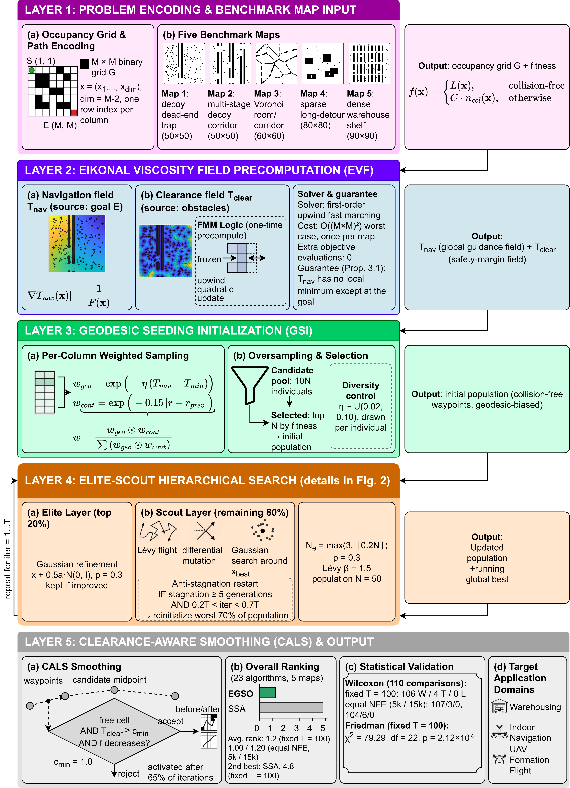
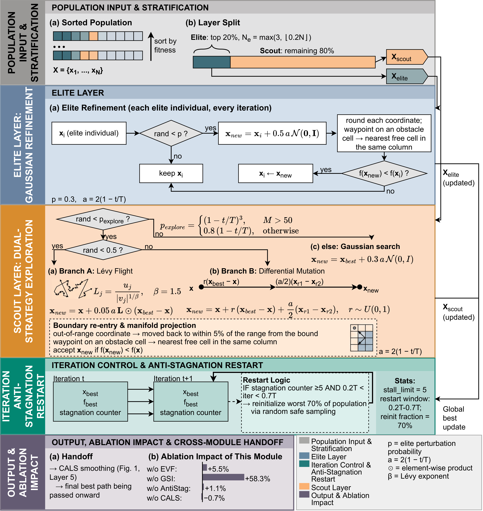
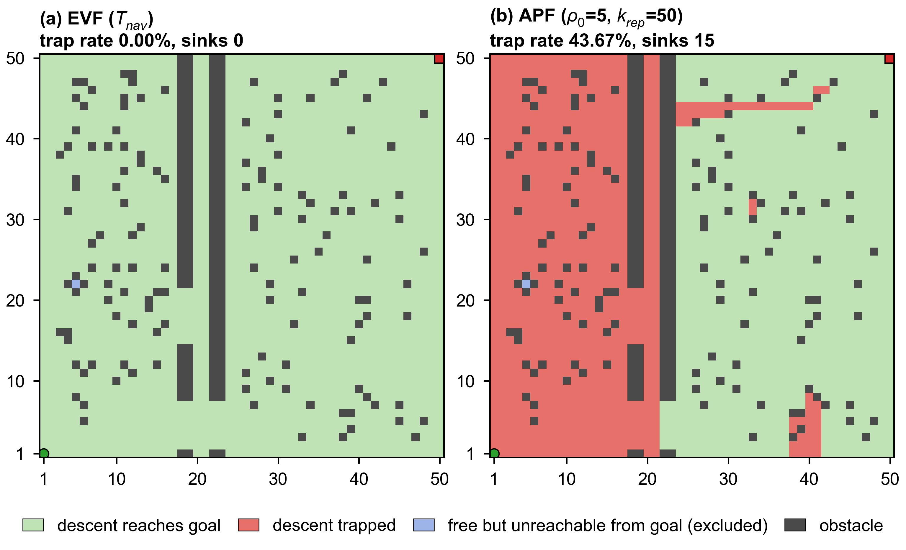
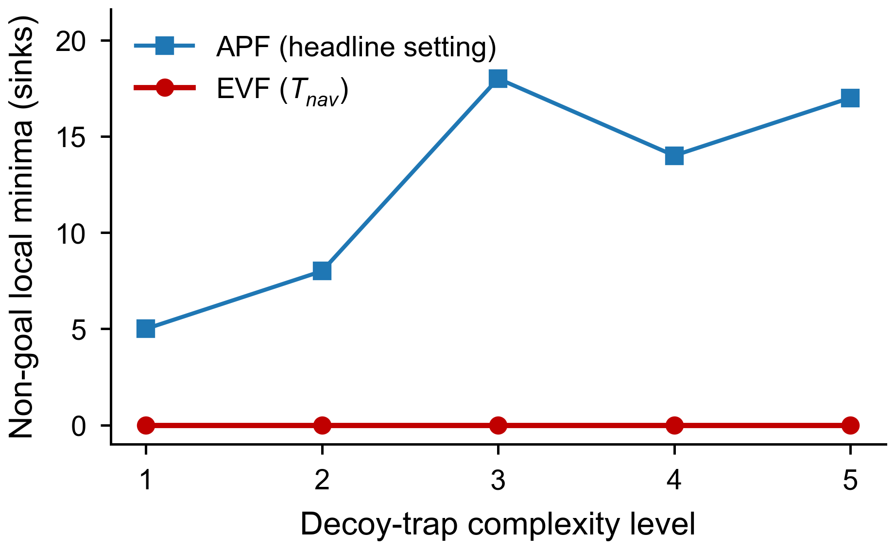
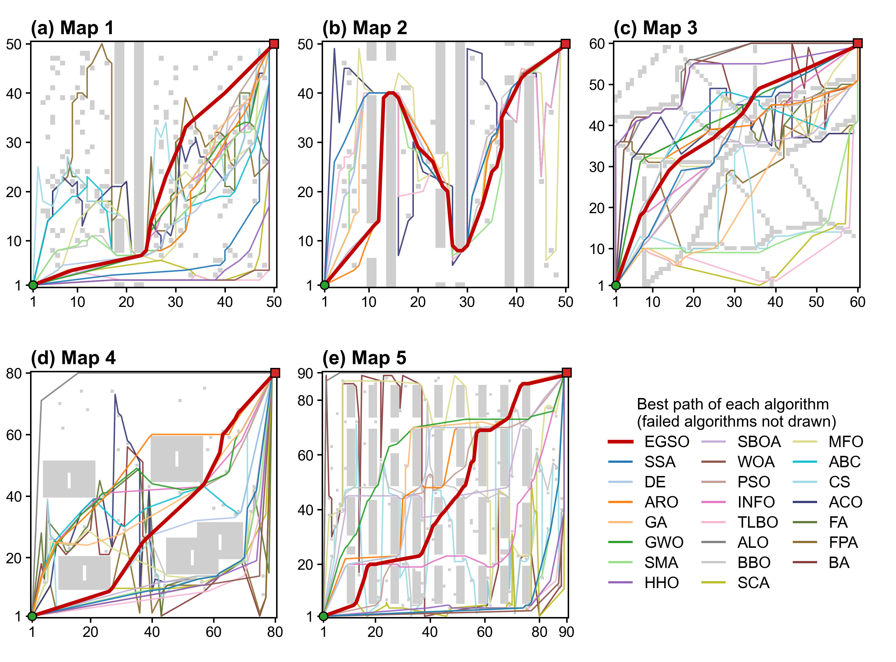
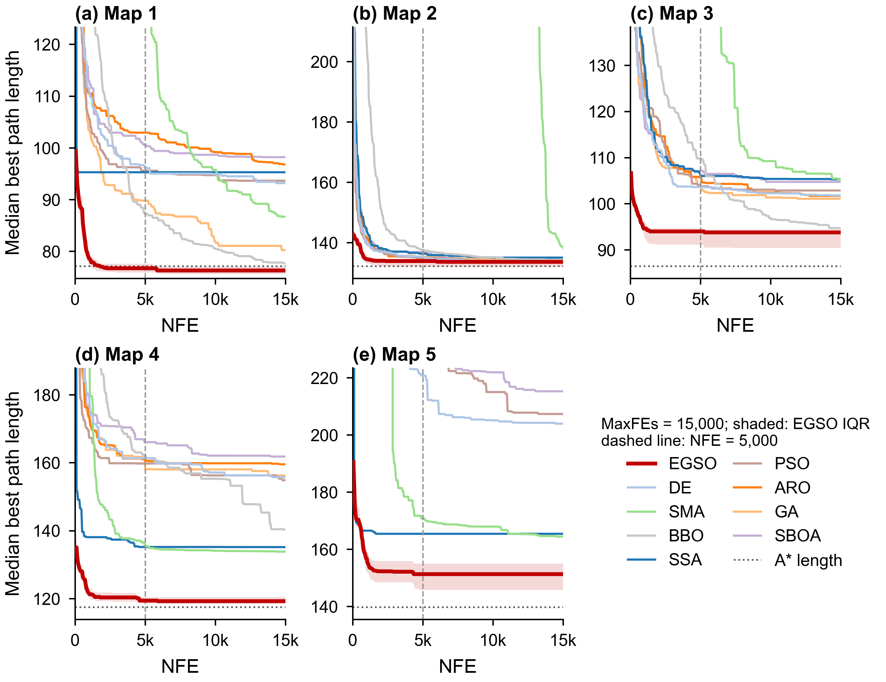

<h1 align="center">EGSO</h1>

<p align="center"><b>An Eikonal-Guided Swarm Optimization Paradigm with a Provably Local-Minima-Free Navigation Field for Path Planning</b></p>

<p align="center">
  
  <a href="LICENSE"></a>
  
  
</p>

<p align="center"><b>English</b> | <a href="README_zh-CN.md">简体中文</a></p>

<p align="center">
  
</p>

Code, benchmark maps and the raw results of every experiment in the paper

> X. Zhang, Q. Wang, C. Yue, Z. Cheng, C. Mei, J. Liu, Z. Li, and C. Yuan, "EGSO: An Eikonal-Guided Swarm Optimization Paradigm with a Provably Local-Minima-Free Navigation Field for Path Planning," *Journal of King Saud University – Computer and Information Sciences*, accepted, 2026.

EGSO builds a swarm optimizer around the viscosity solution of the Eikonal equation. By Sethian's consistency theorem this field has no spurious local minimum away from the goal, which hand-crafted potential fields cannot guarantee. The pipeline has four modules:

1. **EVF** (Eikonal Viscosity Field) solves a navigation field and a clearance field once per map with a self-contained fast-marching solver.
2. **GSI** (Geodesic Seeding Initialization) samples a feasible initial population from the navigation field, biased towards the global geodesic.
3. **Elite-scout hierarchical search**: the elite layer is refined by Gaussian perturbation; scouts keep diversity with Lévy flight and differential mutation.
4. **CALS** (Clearance-Aware Laplacian Smoothing) straightens the final path only where the clearance field allows it.

## Highlights

- **The guarantee is measured, not only cited.** An exhaustive census over 10 benchmark and stress-test maps finds a **0% trap rate** for the Eikonal field on every map, while a parameter-swept potential field traps **17.67%–78.33%** of the free space.
- **Fixed iteration budget (N = 50, T = 100).** EGSO ranks first on average (**1.2** of 23 algorithms) with **106 significant Wilcoxon wins and no loss** in 110 comparisons (Friedman χ² = 79.29, p = 2.1×10⁻⁸).
- **Equal evaluation budget.** With every algorithm limited to the same number of objective evaluations, EGSO ranks first on **all five maps at 5,000** and on four of five at 15,000, with **no significant loss in 220** comparisons.
- **Beyond swarm baselines.** Shorter mean paths than RRT* and Informed-RRT* on every map; 100% success on a 220×220 map where GWO drops to 0%; a minimal 3D voxel proof-of-concept.
- **Toolbox-free and reproducible.** Pure MATLAB (fast marching, Wilcoxon and Friedman tests are implemented here). The raw `.mat` results of every experiment are included.

<p align="center">
  
  <br><em>Architecture of the elite-scout hierarchical search (Fig. 2)</em>
</p>

## Results at a glance

<table>
  <tr>
    <td width="50%"></td>
    <td width="50%"></td>
  </tr>
  <tr>
    <td align="center"><em>Map 1: cells whose greedy descent reaches the goal (green) or gets trapped (red), Eikonal field vs. potential field</em></td>
    <td align="center"><em>Spurious local minima versus decoy-trap complexity</em></td>
  </tr>
</table>

Mean path length of valid runs (20 runs, N = 50, T = 100). A* is the deterministic 8-connected reference; FMM-descent is greedy descent on the same Eikonal field that EGSO uses.

| Map | Size | Layout | EGSO | A* | FMM-descent | RRT* | Informed-RRT* |
|---|:---:|---|---:|---:|---:|---:|---:|
| Map 1 | 50×50 | decoy dead-end trap | **76.99** | 77.11 | 79.30 | 79.79 | 81.31 |
| Map 2 | 50×50 | three-stage decoy corridor | 133.41 | **132.19** | 142.43 | 139.05 | 147.22 |
| Map 3 | 60×60 | Voronoi rooms and corridors | 92.17 | **86.45** | 90.58 | 95.48 | 93.25 |
| Map 4 | 80×80 | sparse long-detour network | 119.60 | **117.44** | 118.36 | 129.53 | 128.09 |
| Map 5 | 90×90 | dense warehouse shelves | 152.81 | **139.68** | 147.75 | 162.20 | 160.75 |

EGSO's best run is shorter than A* on Map 1 (75.40) and Map 4 (116.89): after smoothing, EGSO's paths can take any-angle shortcuts, while A* is restricted to eight directions before the same smoothing. The comparison with the 22 swarm and evolutionary baselines is in `results/main/Statistics_Summary.txt`.

<table>
  <tr>
    <td width="50%"></td>
    <td width="50%"></td>
  </tr>
  <tr>
    <td align="center"><em>Best paths of the 23 algorithms on the five maps</em></td>
    <td align="center"><em>Median best-so-far path length versus objective evaluations</em></td>
  </tr>
</table>

---

## Contents

```
EGSO/
├── egso/                     EGSO and its shared problem definition
│   ├── EGSO.m                the algorithm (four modules)
│   ├── FastMarchingField.m   first-order fast marching (Eikonal viscosity solution)
│   ├── fitness.m             objective: smoothed path length, 1e6 per collision
│   ├── generateContinuousRoute.m, GenerateSmoothPath.m   path decoding and smoothing
│   └── variants/             ablation, factorial, sensitivity and clearance variants
├── egso3d/                   3D voxel proof-of-concept (EGSO3D, 3D fast marching, GWO3D)
├── baselines/
│   ├── metaheuristics/       22 competing algorithms (GWO, PSO, GA, DE, SSA, ..., INFO, SBOA, ARO)
│   └── planners/             A*, APF-weighted A*, FMM-descent, RRT* / Informed-RRT*
├── fields/                   APF, BFS and chamfer fields, greedy-descent local-minima census
├── maps/                     benchmark, stress-test and scalability map generators
├── stats/                    toolbox-free Wilcoxon rank-sum and Friedman tests
├── experiments/              one script per experiment of the paper (see below)
│   └── equal_nfe/            equal-evaluation-budget protocol (counting fitness wrapper)
├── results/                  raw outputs of the runs reported in the paper (see results/README.md)
├── examples/quickstart.m     solve one map and plot the field and the path
├── tests/                    smoke and unit tests (run_all_tests.m)
├── docs/                     figures and implementation notes
├── setup_egso.m              adds the code folders to the MATLAB path
├── reproduce_check.m         checks key numbers of the paper in about one minute
├── README_zh-CN.md           Chinese version of this file
├── CITATION.cff
└── LICENSE
```

## Requirements

- MATLAB R2023b or later (developed and tested on R2023b, macOS). **No toolbox is required**: the fast-marching solver, the weighted sampler, and the Wilcoxon and Friedman tests are implemented in this repository.
- Optional: Python 3 with NumPy and SciPy, only for `experiments/equal_nfe/analyze_perf_nfe.py`.

## Quick start

```matlab
cd EGSO            % repository root
setup_egso         % add the code folders to the path
quickstart         % Map 1: Eikonal field, local-minima census, EGSO path (about 5 s)
reproduce_check    % recompute key numbers of the paper and compare (about 1 min)
run_all_tests      % smoke and unit tests (2-3 min)
```

Using EGSO on your own grid map (`G`: M×M, 1 = obstacle, 0 = free; start (1,1), goal (M,M)):

```matlab
fobj = @(x) fitness(x, G);
[best_len, best_x, curve] = EGSO(50, 100, 1, size(G,1), size(G,1) - 2, fobj, G);
```

The path is encoded as one row index per interior column (`dim = M - 2`), the encoding shared by all 23 algorithms in the comparison; `examples/quickstart.m` shows how to decode `best_x` into the smoothed path.

## Reproducing the paper

Run every script from the repository root after `setup_egso`. Each script writes to the folder listed below; the shipped files in `results/` are the outputs used in the paper.

| Paper | Script | Output |
|---|---|---|
| §4.2 Local-minima census | `Run_LocalMinimaCensus`, `Run_ChamferCensus` | `results/localmin/` |
| §4.3 Main comparison (23 algorithms × 5 maps × 20 runs) | `Run_Comparison_SingleMap(m)` for m = 1..5, then `Aggregate_Comparison_Results` | `results/main/` |
| §4.4 Equal evaluation budget (5,000 / 15,000) | `experiments/equal_nfe/run_all_jobs.sh`, `Fixup_EarlyFinish`, `Aggregate_EqualNFE` | `runs/equal_nfe/` (shipped: `results/equal_nfe/`) |
| §4.5 Ablation | `Main_Ablation_Experiment` | `results/ablation/` |
| §4.5 Factorial ablation and seeding fields | `Main_FactorialAblation`, `Main_FactorialAblation2`, `Run_PooledSeedingFields` | `results/factorial*/` |
| §4.6 Classical references (A*, APF-A*, FMM-descent) | `Run_ClassicalBaselines`, `Run_APFAStar_Baseline` | `results/main/` |
| §4.7 Sampling-based references | `Run_SamplingBaselines`, `Run_SamplingSignificance` | `results/sampling/` |
| §4.7 End-to-end runtime | `Run_EVFPrecompute_MainMaps`, `Run_CleanTiming_MainMaps`, `Build_EndToEnd_Runtime_Table` | `results/main/` |
| §4.8 Significance tests | `Run_SignificanceTests_v2`, `Run_FriedmanPaperConvention` | `results/main/` |
| §4.9 Local-minima stress test | `Main_LocalMinima_StressTest`, `Run_StressLevel5_Connectivity` | `results/stress/` |
| §4.10 Scalability (90 to 220) and iteration budget | `Run_Scalability`, `Run_IterationBudgetSweep` | `results/scalability/`, `results/main/` |
| §4.11 3D proof-of-concept | `Run_3DProofOfConcept` | `results/3d/` |
| §4.12 Execution-noise robustness | `Main_NoiseRobustness_v2`, `Main_ClearanceTunable_NoiseTest` | `results/noise/` |
| §4.13 Sensitivity analysis | `Run_SensitivityAnalysis`, `Run_SensitivityAnalysis2` | `results/main/` |
| Appendix B, evaluations per run | `experiments/equal_nfe/Run_NFE_T100` | `results/equal_nfe/nfe_t100/` |

The main comparison was run as five parallel single-map processes (about one hour on a 10-core laptop), for example:

```bash
for m in 1 2 3 4 5; do matlab -batch "setup_egso; Run_Comparison_SingleMap($m)" & done; wait
matlab -batch "setup_egso; Aggregate_Comparison_Results"
```

`Main_Comparison_Experiment` runs the same comparison in one process; it is set to a small smoke-test configuration at the top of the file. The equal-budget experiment takes about three hours with nine parallel processes.

## Implementation notes

Points a reader needs in order to interpret or reproduce the numbers; details are in [`docs/IMPLEMENTATION_NOTES.md`](docs/IMPLEMENTATION_NOTES.md).

- **Shared local search in eight baselines.** GWO, PSO, GA, DE, SSA, INFO, SBOA and ARO apply a greedy coordinate-wise local search (`LocalSearch.m`) to their best solution once per iteration. This favours these baselines and is documented in Appendix A of the paper.
- **Counting evaluations.** `FobjCounter` does not see the direct `fitness()` calls inside `LocalSearch.m`. The complete counts (Appendix B) and the equal-budget protocol use the shadowing `experiments/equal_nfe/fitness.m`, which counts every call.
- **Elite step.** An earlier implementation also moved elite individuals along the field gradient. Because the step was at most 0.1 cells and the decision variables are rounded to integer rows, it never changed a candidate; it was removed, and all fixed-budget results are bit-identical with and without it.
- **Friedman convention.** The paper ranks algorithms with 0% success on a map last and breaks their ties by listing order (χ² = 79.29, `Run_FriedmanPaperConvention`); with average ranks for these ties the same data give χ² = 74.30 (`Run_SignificanceTests_v2`).
- **Random streams.** The main comparison relies on MATLAB's default stream at session start (one fresh process per map); the equal-budget, timing and 3D experiments seed every run explicitly.

## Citation

If you use this code or the benchmark maps, please cite:

```bibtex
@article{zhang2026egso,
  title   = {{EGSO}: An Eikonal-Guided Swarm Optimization Paradigm with a Provably Local-Minima-Free Navigation Field for Path Planning},
  author  = {Zhang, Xiang and Wang, Qiang and Yue, ChaoFan and Cheng, Zhiwei and Mei, Chenrui and Liu, Jinjiang and Li, ZhenNing and Yuan, Chunhong},
  journal = {Journal of King Saud University -- Computer and Information Sciences},
  year    = {2026},
  note    = {Accepted}
}
```

## License

Released under the [MIT License](LICENSE). The 22 baseline metaheuristics are implementations of the published algorithms (cited in the paper) adapted to the grid-path encoding used here.
