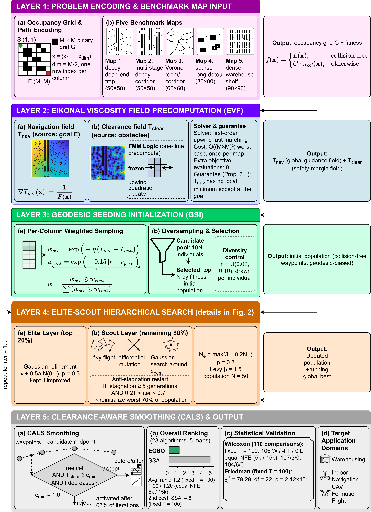
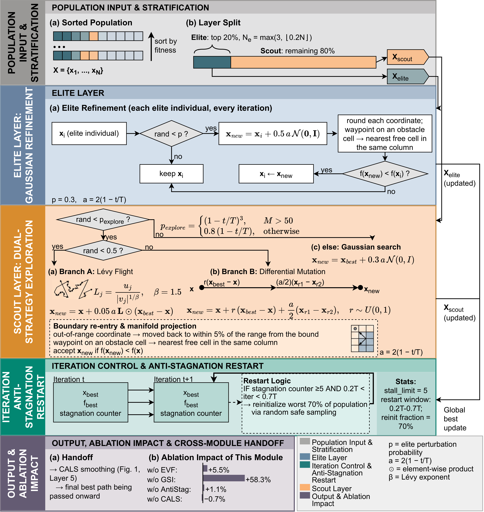
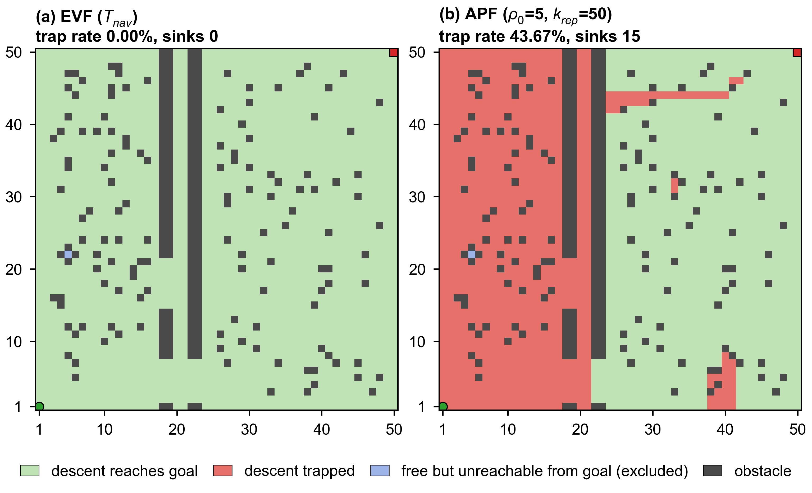
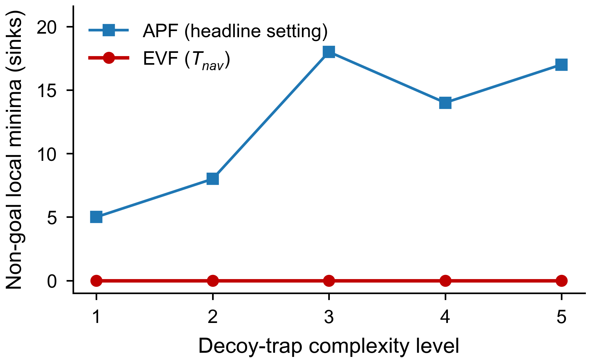

<h1 align="center">EGSO</h1>

<p align="center"><b>具有可证无局部极小导航场的 Eikonal 引导群智能优化范式及其路径规划应用</b></p>

<p align="center">
  
  <a href="LICENSE"></a>
  
  
</p>

<p align="center"><a href="README.md">English</a> | <b>简体中文</b></p>

<p align="center">
  
</p>

本仓库包含论文的代码、基准地图以及全部实验的原始结果：

> X. Zhang, Q. Wang, C. Yue, Z. Cheng, C. Mei, J. Liu, Z. Li, and C. Yuan, "EGSO: An Eikonal-Guided Swarm Optimization Paradigm with a Provably Local-Minima-Free Navigation Field for Path Planning," *Journal of King Saud University – Computer and Information Sciences*, accepted, 2026.

EGSO 以 Eikonal 方程的粘性解为核心构建群智能优化器。根据 Sethian 一致性定理，该场在目标点以外不存在伪局部极小，这一点是手工势场无法保证的。算法由四个模块组成：

1. **EVF**（Eikonal 粘性场）：用自实现的快速行进法，每张地图只求解一次导航场和净空场。
2. **GSI**（测地线播种初始化）：在导航场上加权采样，得到全部可行且偏向全局测地线的初始种群。
3. **精英-侦察分层搜索**：精英层做高斯扰动精修，侦察层用 Lévy 飞行和差分变异保持多样性。
4. **CALS**（净空感知拉普拉斯平滑）：只在净空场允许的位置拉直最终路径。

## 主要结果

- **理论保证有实测支撑**：在 10 张基准和压力测试地图上做穷举普查，Eikonal 场的陷阱率在每张图上都是 **0%**；参数扫描后的人工势场陷阱率为 **17.67%–78.33%**。
- **固定迭代预算（N = 50，T = 100）**：EGSO 在 23 个算法中平均排名第一（**1.2**），110 次 Wilcoxon 检验中 **106 次显著胜出、0 次显著落败**（Friedman χ² = 79.29，p = 2.1×10⁻⁸）。
- **相同评价次数预算**：所有算法目标函数评价次数相同时，EGSO 在 5,000 次预算下 **五张图全部第一**，15,000 次预算下五张图中四张第一，220 次比较中 **无显著落败**。
- **与非群智能方法比较**：平均路径在每张图上都短于 RRT* 和 Informed-RRT*；220×220 地图上成功率保持 100%，而 GWO 降到 0%；另附三维体素概念验证。
- **不依赖工具箱、可复现**：纯 MATLAB 实现（快速行进法、Wilcoxon 与 Friedman 检验均在仓库内实现），并附全部实验的原始 `.mat` 结果。

<p align="center">
  
  <br><em>精英-侦察分层搜索模块结构（图 2）</em>
</p>

## 结果一览

<table>
  <tr>
    <td width="50%"></td>
    <td width="50%"></td>
  </tr>
  <tr>
    <td align="center"><em>Map 1：贪婪下降能到达目标（绿）与被困（红）的格子，Eikonal 场与势场对比</em></td>
    <td align="center"><em>伪局部极小个数随诱饵陷阱复杂度的变化</em></td>
  </tr>
</table>

有效运行的平均路径长度（20 次运行，N = 50，T = 100）。A* 为确定性 8 连通参照；FMM-descent 为沿 EGSO 所用同一 Eikonal 场的贪婪下降。

| 地图 | 尺寸 | 布局 | EGSO | A* | FMM-descent | RRT* | Informed-RRT* |
|---|:---:|---|---:|---:|---:|---:|---:|
| Map 1 | 50×50 | 诱饵死胡同陷阱 | **76.99** | 77.11 | 79.30 | 79.79 | 81.31 |
| Map 2 | 50×50 | 三级诱饵通道 | 133.41 | **132.19** | 142.43 | 139.05 | 147.22 |
| Map 3 | 60×60 | Voronoi 房间与走廊 | 92.17 | **86.45** | 90.58 | 95.48 | 93.25 |
| Map 4 | 80×80 | 稀疏长绕行网络 | 119.60 | **117.44** | 118.36 | 129.53 | 128.09 |
| Map 5 | 90×90 | 密集仓储货架 | 152.81 | **139.68** | 147.75 | 162.20 | 160.75 |

EGSO 的最优一次运行在 Map 1（75.40）和 Map 4（116.89）上短于 A*：平滑后 EGSO 的路径可以走任意角度的捷径，而 A* 在同样的平滑之前只能走 8 个方向。与 22 个群智能和进化算法的完整比较见 `results/main/Statistics_Summary.txt`。

---

## 目录结构

```
EGSO/
├── egso/                     EGSO 本体与共用的问题定义（目标函数、路径解码与平滑）
│   └── variants/             消融、析因、灵敏度与净空可调变体
├── egso3d/                   三维体素概念验证
├── baselines/
│   ├── metaheuristics/       22 个对比算法
│   └── planners/             A*、APF 加权 A*、FMM-descent、RRT* / Informed-RRT*
├── fields/                   APF、BFS、Chamfer 场与贪婪下降局部极小普查
├── maps/                     基准、压力测试与可扩展性地图生成
├── stats/                    不依赖工具箱的 Wilcoxon 秩和检验与 Friedman 检验
├── experiments/              论文每个实验对应的脚本（见下表）
│   └── equal_nfe/            相同评价次数预算协议（带计数的 fitness 包装）
├── results/                  论文所用运行的原始输出（见 results/README.md）
├── examples/quickstart.m     求解一张地图并画出场和路径
├── tests/                    冒烟测试与单元测试（run_all_tests.m）
├── docs/                     图片与实现说明
├── setup_egso.m              把代码目录加入 MATLAB 路径
└── reproduce_check.m         约一分钟内核对论文中的关键数字
```

## 环境要求

- MATLAB R2023b 或更高版本（在 macOS 上的 R2023b 中开发和测试）。**不需要任何工具箱**。
- 可选：Python 3 + NumPy + SciPy，仅用于 `experiments/equal_nfe/analyze_perf_nfe.py`。

## 快速开始

```matlab
cd EGSO            % 仓库根目录
setup_egso         % 添加路径
quickstart         % Map 1：Eikonal 场、局部极小普查、EGSO 路径（约 5 秒）
reproduce_check    % 重算论文关键数字并比对（约 1 分钟）
run_all_tests      % 冒烟测试与单元测试（2–3 分钟）
```

在自己的栅格地图上使用 EGSO（`G` 为 M×M，1 表示障碍，0 表示自由；起点 (1,1)，终点 (M,M)）：

```matlab
fobj = @(x) fitness(x, G);
[best_len, best_x, curve] = EGSO(50, 100, 1, size(G,1), size(G,1) - 2, fobj, G);
```

路径编码为每个内部列一个行号（`dim = M - 2`），23 个算法共用这一编码；`examples/quickstart.m` 演示如何把 `best_x` 解码成平滑后的路径。

## 复现论文

先运行 `setup_egso`，然后在仓库根目录运行各脚本。论文章节与脚本的对应关系见 [英文 README](README.md#reproducing-the-paper) 中的表格；`results/` 中已附带论文使用的输出。

主对比实验按地图拆成 5 个并行进程运行（10 核笔记本约 1 小时）：

```bash
for m in 1 2 3 4 5; do matlab -batch "setup_egso; Run_Comparison_SingleMap($m)" & done; wait
matlab -batch "setup_egso; Aggregate_Comparison_Results"
```

## 实现说明

- **八个基线带局部搜索**：GWO、PSO、GA、DE、SSA、INFO、SBOA、ARO 每次迭代对当前最优解做一次贪婪逐坐标局部搜索（`LocalSearch.m`），这对它们有利，论文附录 A 已说明。
- **评价次数统计**：`FobjCounter` 统计不到 `LocalSearch.m` 内部直接调用的 `fitness()`。附录 B 的完整计数和相同预算实验使用 `experiments/equal_nfe/fitness.m`，它统计每一次调用。
- **精英场引导步**：早期实现中精英个体还会沿场梯度移动，但步长最多 0.1 格，而决策变量会取整到整数行，因此这一步从未改变过任何候选解。已删除，固定预算下的全部结果删除前后逐位相同。
- **Friedman 约定**：论文把某张图上成功率为 0% 的算法排在最后，并按算法列表顺序打破并列（χ² = 79.29，见 `Run_FriedmanPaperConvention`）；若对这些并列取平均秩，同一数据得到 χ² = 74.30（`Run_SignificanceTests_v2`）。

详见 [`docs/IMPLEMENTATION_NOTES.md`](docs/IMPLEMENTATION_NOTES.md)。

## 引用

```bibtex
@article{zhang2026egso,
  title   = {{EGSO}: An Eikonal-Guided Swarm Optimization Paradigm with a Provably Local-Minima-Free Navigation Field for Path Planning},
  author  = {Zhang, Xiang and Wang, Qiang and Yue, ChaoFan and Cheng, Zhiwei and Mei, Chenrui and Liu, Jinjiang and Li, ZhenNing and Yuan, Chunhong},
  journal = {Journal of King Saud University -- Computer and Information Sciences},
  year    = {2026},
  note    = {Accepted}
}
```

## 许可证

[MIT License](LICENSE)。22 个基线算法按原论文（论文中已引用）实现，并适配到本仓库的栅格路径编码。
